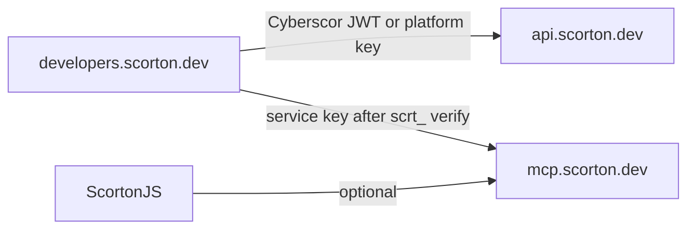

# Architecture

Generate a platform `scrt_` key once: it unlocks API scan, raw MCP (`POST /api/mcp`), and TrustScore. Login JWT upgrades Cyberscor to upstream security scoring.

## Auth layers

| Layer | Credential | Used for |
| --- | --- | --- |
| Portal session | Bearer session | Portal UI, `POST /api/generate-key`, `GET /api/list-keys` |
| Platform key | `x-api-key` or Bearer `scrt_…` | `/api/scan`, `/api/mcp`, `/api/gateway/*`, `/api/verify-key` |
| Cyberscor JWT | `x-cyberscor-token` (or non-`scrt_` Bearer) | Upstream `/v1/cyberscor/score` |
| Service key | `SCORTON_API_KEY` (server env) | Portal → MCP / TrustScore proxy |

## Scoring path

1. **Preferred:** Cyberscor upstream with user JWT  
2. **Fallback:** Portal computes DNS + header-based score when upstream returns container/auth failures  
3. **TrustScore:** Structured findings → `POST /v1/trustscore/review` (usually via gateway + service key)

## What we do not use in this stack

- `https://api.scorton.tech/auth/login` (legacy public docs)
- `https://radar.scorton.tech` key generate/verify
- Undocumented `/scans/` body with `scans: ["dns","ports"]` as the portal's scan UI path
